  

       

---

# 🚀 Awesome Vector Database & Semantic Search

A curated directory and engineering guide to **Vector Databases**, **Semantic Search Engines**, **Neural Information Retrieval**, and **Vector Indexing Infrastructure**. Whether you are architecting a production **Retrieval-Augmented Generation (RAG)** pipeline, scaling high-dimensional embeddings search to billions of records, or selecting between hosted cloud databases and open-source self-hosted solutions, this repository aggregates key benchmarks, verified pricing, free tier allocations, and technical capabilities.

---

## 📑 Table of Contents

- [🌐 Sector Overview & Market Dynamics](#-sector-overview--market-dynamics)
- [☁️ SaaS & Hosted Platforms](#️-saas--hosted-platforms)
- [🔓 Open-Source Vector Databases & Engines](#-open-source-vector-databases--engines)
  - [📊 Star-Ranked Quick Comparison](#-star-ranked-quick-comparison)
  - [🔍 In-Depth Open-Source Engine Profiles](#-in-depth-open-source-engine-profiles)
- [🧠 Architectural Selection Guide & Trade-Offs](#-architectural-selection-guide--trade-offs)
- [🤝 How to Contribute](#-how-to-contribute)
- [⭐ Star History](#-star-history)
- [💖 Support & Community](#-support--community)
- [📜 Disclaimer & License](#-disclaimer--license)

---

## 🌐 Sector Overview & Market Dynamics

- **Estimated Market Size**: The global vector database and neural search market was valued at approximately **$1.85 billion in 2024** and is projected to expand to **$8.6 to $11.2 billion by 2030**, advancing at a robust compound annual growth rate (**CAGR of ~28.5%**). This expansion is fueled by enterprise generative AI applications, high-dimensional multimodal embedding storage, and demand for sub-10ms semantic retrieval across enterprise document repositories.
- **Market Structure & Fragmentation**: The sector exhibits **moderate fragmentation with dual convergence** rather than a winner-take-all monopoly. Pure-play vector specialists (*Pinecone, Qdrant, Weaviate, Milvus/Zilliz*) lead in high-throughput dedicated similarity retrieval, advanced graph traversals (HNSW, DiskANN), and filtered vector indexing. Simultaneously, incumbent transactional and search systems (*Elasticsearch, PostgreSQL via pgvector, Redis, MongoDB*) are aggressively integrating native vector search, capturing baseline workloads where developer velocity and operational consolidation outweigh specialized single-purpose vector cluster management.

---

## ☁️ SaaS & Hosted Platforms

The table below catalogs managed vector search platforms and hosted retrieval APIs, sorted in **descending order by company scale (valuation / annual revenue)**. Starting prices and free tier boundaries reflect current verified platform specifications.

| Platform / SaaS Product | Company Scale (Valuation / Revenue) | Starting Tier Pricing | Free Tier / Trial Limits | Core Focus & Retrieval Capabilities |
| :--- | :--- | :--- | :--- | :--- |
| **[Elastic Vector Search](https://www.elastic.co/)** | **~$7.2B** Market Cap / **$1.4B ARR** (NYSE: ESTC) | **$95/month** (Standard Elastic Cloud tier or ~$0.13/hr on AWS/GCP/Azure) | **14-day free trial** with full cluster capacity, Kibana UI, Lucene-based vector search, and Prometheus remote write (no credit card required) | Full-text + dense vector hybrid search; deep enterprise observability, APM integration, and hybrid BM25 + dense ranking. |
| **[Cohere](https://cohere.com/)** | **~$5.5B** Valuation (Series D; ~$35M+ ARR) | **$0.10 / 1M tokens** (Embed v3) & **$2.00 / 1K queries** (Rerank v3) | **Free Forever Trial API** with **1,000 requests/month** rate-limited to 10 requests/minute for non-production development | Multilingual embeddings with int8/binary compression, cross-encoder reranking models, and enterprise retrieval APIs. |
| **[Pinecone](https://www.pinecone.io/)** | **~$1.0B** Valuation (Series B; $138M funding) | **$0.33 / 1M read units** + $0.05/GB/mo (Serverless) or **$0.051/pod-hr** (~$37/mo standard pods) | **Free Forever Starter plan** with **2 GB storage**, 1 project, up to **1 index**, and 100K queries/month on serverless | Fully serverless vector database; automated index lifecycle, horizontal partitioning, zero cluster operations. |
| **[Zilliz Cloud](https://zilliz.com/)** | **~$600M** Valuation (Series B+; $113M funding) | **$0.095/hour per CU** (~$68.40/month per dedicated Capacity Unit) | **30-day free trial** with **$100 free credit**, supporting up to **5 collections** and 10M vectors | Fully managed Milvus; disaggregated compute-storage architecture, high concurrency, and billion-scale index scaling. |
| **[Weaviate Cloud](https://weaviate.io/)** | **~$200M** Valuation (Series B; $67.5M funding) | **$0.035 / 1M vector dimensions/month** + **$25/month** per active standard cluster | **14-day free sandbox cluster** with up to **1M objects/vectors** and full hybrid search capability | Native dense + BM25 hybrid search, modular vectorizers, GraphQL & REST interfaces, and automatic data replication. |
| **[Qdrant Cloud](https://qdrant.tech/cloud/)** | **~$150M** Valuation (Series A; $37.8M funding) | **$25/month** (Dedicated 0.5 vCPU, 2GB RAM, 10GB SSD cluster) | **Free Forever 1GB cluster** (0.5 vCPU, 1GB RAM, 4GB disk) storing up to **~100K vectors** with no expiration | Rust-native vector database; payload-aware HNSW traversal filtering, low latency, native hybrid dense-sparse vectors. |
| **[Marqo Cloud](https://www.marqo.ai/)** | **~$60M** Valuation (Series A; $17.8M funding) | **$0.14/compute-hour** (~$99/month for small single replica) | **14-day free trial** with **$50 free compute credits** to create and query multimodal indexes | End-to-end multimodal search (text, image, audio), integrated tensor embedding inference, and e-commerce discovery. |
| **[Deepset Cloud](https://www.deepset.ai/)** | **~$50M** Valuation (Series B; $30M funding) | **$399/month** (Starter Team tier with managed pipelines and API endpoints) | **14-day free trial** with full pipeline prototyping, evaluation UI, and **500 search queries** | Managed Haystack-based RAG pipelines, prompt engineering workspace, automated retrieval evaluation, and tracing. |
| **[SciPhi](https://www.sciphi.ai/)** | **~$10M** Valuation (Seed stage; $2.5M funding) | **$20/month** (Developer tier for structured document ETL and retrieval APIs) | **Free Forever Developer tier** with **500 extract/search requests/month** and up to 100 documents ingested | RAG-as-a-service, automated document extraction, multi-agent retrieval orchestration (Indexify framework). |

---

## 🔓 Open-Source Vector Databases & Engines

Self-hosted vector databases provide complete data sovereignty, customized index tuning, zero per-query network fees, and predictable hardware budgeting.

### 📊 Star-Ranked Quick Comparison

The table below lists the top open-source projects, sorted strictly in **descending order by GitHub Stars_Count**. Each Stars_Badge links directly to the project's stargazers page.

| Rank | Project | GitHub_Stars_Badge | Language / Core Engine | Primary Use Case & Architecture |
| :---: | :--- | :---: | :---: | :--- |
| 1 | **[Meilisearch](https://github.com/meilisearch/meilisearch)** |  | Rust | Lightning-fast typo-tolerant search engine with integrated AI vector embeddings and hybrid search. |
| 2 | **[Milvus](https://github.com/milvus-io/milvus)** |  | Go / C++ | Cloud-native distributed vector database built for billion-scale ANN search and independent component scaling. |
| 3 | **[FAISS](https://github.com/facebookresearch/faiss)** |  | C++ / Python | Meta's foundational library for dense vector similarity search, clustering, and GPU-accelerated indexing. |
| 4 | **[Qdrant](https://github.com/qdrant/qdrant)** |  | Rust | High-performance vector database with payload-aware graph filtering, Raft consensus, and hybrid dense-sparse search. |
| 5 | **[Chroma](https://github.com/chroma-core/chroma)** |  | Python / Rust | AI-native embedded vector database designed for developer ergonomics, local prototyping, and LLM memory. |
| 6 | **[pgvector](https://github.com/pgvector/pgvector)** |  | C | Open-source vector similarity search extension for PostgreSQL (HNSW and IVFFlat indexing). |
| 7 | **[Weaviate](https://github.com/weaviate/weaviate)** |  | Go | Cloud-native vector database featuring native hybrid dense/BM25 search, modular vectorizers, and GraphQL APIs. |
| 8 | **[txtai](https://github.com/neuml/txtai)** |  | Python | All-in-one embeddings database, LLM pipeline orchestrator, workflow engine, and semantic graph index. |
| 9 | **[LanceDB](https://github.com/lancedb/lancedb)** |  | Rust / Python | Serverless, embedded vector database built on Lance columnar format for disk-backed multimodal retrieval. |
| 10 | **[Deep Lake](https://github.com/activeloopai/deeplake)** |  | C++ / Python | AI data runtime and multimodal vector lake for deep learning training, serverless query, and agentic RAG. |
| 11 | **[Vespa](https://github.com/vespa-engine/vespa)** |  | C++ / Java | Yahoo's enterprise search and ranking engine combining vector ANN, lexical BM25, and phased machine learning reranking. |
| 12 | **[Marqo](https://github.com/marqo-ai/marqo)** |  | Python / C++ | Multimodal tensor search engine with out-of-the-box embedding model execution and e-commerce relevancy ranking. |
| 13 | **[Infinity](https://github.com/infiniflow/infinity)** |  | C++ | AI-native database delivering ultra-fast hybrid search across dense vectors, sparse vectors, multi-vector tensors, and full-text. |
| 14 | **[USearch](https://github.com/unum-cloud/USearch)** |  | C++ / Multi | Compact single-header similarity search engine with 15+ quantization levels and multi-language bindings. |
| 15 | **[pgvecto.rs](https://github.com/tensorchord/pgvecto.rs)** |  | Rust | Rust-engineered vector search extension for PostgreSQL featuring asynchronous indexing, Vamana, and FP16 quantization. |
| 16 | **[Vald](https://github.com/vdaas/vald)** |  | Go / C++ | Cloud-native distributed approximate nearest neighbor dense vector search engine based on NGT graph algorithms. |

---

### 🔍 In-Depth Open-Source Engine Profiles

#### 1. [Meilisearch](https://github.com/meilisearch/meilisearch) 
- **Architecture**: Rust-based, typo-tolerant search engine with integrated AI vector search capabilities.
- **Highlights**: Combines instantaneous full-text keyword retrieval with semantic dense vector similarity for out-of-the-box hybrid search. Supports auto-embedding generation using OpenAI, Hugging Face, or custom models.
- **Best For**: Front-facing search bars, e-commerce discovery, and developer teams wanting sub-50ms search with minimal configuration.

#### 2. [Milvus](https://github.com/milvus-io/milvus) 
- **Architecture**: Disaggregated cloud-native architecture separating stateless compute (query nodes, data nodes, coordinator) from persistent storage (MinIO/S3, etcd).
- **Highlights**: Built for enterprise billion-scale vector workloads. Provides independent horizontal scaling of indexing and query operations, multi-tenancy, partition keys, and hardware acceleration with GPUs.
- **Best For**: Large-scale production platforms, enterprise Kubernetes environments, and datasets with >50 million vectors.

#### 3. [FAISS](https://github.com/facebookresearch/faiss) 
- **Architecture**: C++ library with comprehensive Python bindings developed by Meta AI Research.
- **Highlights**: Gold standard for high-performance vector similarity search and clustering. Features GPU acceleration, product quantization (PQ), IVF, and HNSW indexes. Runs in-memory without native network clustering.
- **Best For**: High-throughput offline batch similarity search, embedding clustering, research benchmarks, and custom vector service backends.

#### 4. [Qdrant](https://github.com/qdrant/qdrant) 
- **Architecture**: Rust-native distributed vector search engine using payload-aware HNSW graph traversal.
- **Highlights**: Eliminates post-filtering accuracy degradation by evaluating payload predicates directly during graph exploration. Supports dense + sparse hybrid vectors, Raft-based distributed clustering, and memory-mapped disk storage.
- **Best For**: Complex metadata filtering requirements, multi-tenant RAG applications, and production workloads under 50M vectors.

#### 5. [Chroma](https://github.com/chroma-core/chroma) 
- **Architecture**: Embedded and client-server vector store built with Python and Rust, using DuckDB/SQLite metadata storage and HNSWlib.
- **Highlights**: Premier choice for rapid prototyping, LangChain/LlamaIndex integration, and local experimentation. Provides simple `add()`, `query()`, and `delete()` ergonomics.
- **Best For**: Local AI desktop applications, LLM hackathons, prototype RAG architectures, and embedded edge systems.

#### 6. [pgvector](https://github.com/pgvector/pgvector) 
- **Architecture**: C extension adding vector data types and ANN similarity indexes (`hnsw` and `ivfflat`) to standard PostgreSQL.
- **Highlights**: Eliminates the operational overhead of managing a separate vector database. Inherits PostgreSQL ACID guarantees, replication, backup tooling, row-level security, and relational joins.
- **Best For**: Existing PostgreSQL environments adding semantic search to relational records without introducing new infrastructure.

#### 7. [Weaviate](https://github.com/weaviate/weaviate) 
- **Architecture**: Go-based vector database utilizing custom HNSW + LSM-Tree inverted index architecture.
- **Highlights**: First-class hybrid search combining dense neural retrieval with sparse BM25 keyword scoring using reciprocal rank fusion (RRF). Offers modular vectorizers and built-in multimodal support.
- **Best For**: Hybrid keyword-vector search workloads, knowledge graphs, and applications needing plug-and-play inference integrations.

#### 8. [txtai](https://github.com/neuml/txtai) 
- **Architecture**: Python-based all-in-one embeddings database, LLM pipeline orchestrator, and semantic graph engine.
- **Highlights**: Unifies semantic vector search with transformer pipelines (summarization, translation, Q&A, transcription) and graph topic modeling. Runs natively in Python with zero external service dependencies.
- **Best For**: Full-stack Python AI pipelines seeking an all-in-one alternative to separate vector DB + LangChain setups.

#### 9. [LanceDB](https://github.com/lancedb/lancedb) 
- **Architecture**: Serverless, embedded vector database built on the Lance columnar data format in Rust.
- **Highlights**: Designed for disk-backed vector storage with zero RAM indexing requirements. Queries directly from object storage (S3/GCS) or local NVMe drives with sub-millisecond latency.
- **Best For**: Multimodal RAG (video, audio, high-resolution imagery), embedded serverless execution, and cost-conscious storage.

#### 10. [Deep Lake](https://github.com/activeloopai/deeplake) 
- **Architecture**: AI Data Runtime and multimodal vector database optimized for deep learning and agentic workflows.
- **Highlights**: Stores complex multimodal data (images, video, audio, text embeddings) with version control, streaming data loaders for PyTorch/TensorFlow, and serverless querying.
- **Best For**: Deep learning training pipelines, computer vision semantic search, and autonomous multi-agent memory systems.

#### 11. [Vespa](https://github.com/vespa-engine/vespa) 
- **Architecture**: Enterprise-scale distributed engine for vector, lexical, and structured search developed by Yahoo.
- **Highlights**: Supports multi-phased ranking with ONNX runtime model execution at query time. Combines HNSW vector search, BM25 text search, and complex boolean filtering over billions of documents.
- **Best For**: Large-scale e-commerce recommendation platforms, mission-critical search engines, and multi-stage ML re-ranking.

#### 12. [Marqo](https://github.com/marqo-ai/marqo) 
- **Architecture**: Tensor-based search engine integrating embedding inference directly into the search index.
- **Highlights**: Ingests raw text and images without requiring a separate embedding generation service. Automatically generates tensor representations and executes HNSW search.
- **Best For**: Multimodal e-commerce catalogs, visual search, and teams wanting to eliminate external embedding pipelines.

#### 13. [Infinity](https://github.com/infiniflow/infinity) 
- **Architecture**: C++ AI-native database tailored for LLM and RAG workloads.
- **Highlights**: Extreme hybrid retrieval performance combining dense vectors, sparse vectors, multi-vector ColBERT tensor representations, and full-text keyword indexing within a unified engine.
- **Best For**: Advanced RAG pipelines requiring ColBERT-style late interaction re-ranking and multi-vector similarity.

#### 14. [USearch](https://github.com/unum-cloud/USearch) 
- **Architecture**: Compact, single-header C++ vector search and clustering engine with SIMD optimizations.
- **Highlights**: 3x faster than standard HNSWlib implementations, supporting 15+ quantization formats (down to 1-bit binary vectors). Embeddable in C++, Rust, Python, Go, Java, and Node.js.
- **Best For**: High-performance embedded systems, memory-constrained edge devices, and custom vector search infrastructure.

#### 15. [pgvecto.rs](https://github.com/tensorchord/pgvecto.rs) 
- **Architecture**: Rust-engineered vector extension for PostgreSQL developed by TensorChord.
- **Highlights**: Introduces Vamana graph indexing and FP16/INT8 scalar quantization into PostgreSQL. Delivers up to 4x higher QPS and lower latency than traditional pgvector indexes on large datasets.
- **Best For**: PostgreSQL teams running high-throughput vector queries that exceed default pgvector index performance limits.

#### 16. [Vald](https://github.com/vdaas/vald) 
- **Architecture**: Cloud-native distributed approximate nearest neighbor vector search engine from Yahoo Japan.
- **Highlights**: Utilizes NGT (Neighborhood Graph and Tree) algorithm with asynchronous indexing and distributed agent architecture. Integrates natively with Kubernetes environments.
- **Best For**: Cloud-native enterprise teams managing distributed Kubernetes clusters requiring scalable NGT graph search.

---

## 🧠 Architectural Selection Guide & Trade-Offs

When choosing between vector databases and search engines, evaluate your system against these core technical criteria:

1. **Scale Ceiling & Operational Complexity**:
   - For **prototyping or embedded workloads (< 1M vectors)**: Use [Chroma](https://github.com/chroma-core/chroma) or [LanceDB](https://github.com/lancedb/lancedb). They require zero infrastructure setup.
   - For **existing PostgreSQL applications (< 5M vectors)**: Use [pgvector](https://github.com/pgvector/pgvector) or [pgvecto.rs](https://github.com/tensorchord/pgvecto.rs) to avoid maintaining a separate cluster.
   - For **billion-scale enterprise production**: Use [Milvus](https://github.com/milvus-io/milvus) or [Qdrant](https://github.com/qdrant/qdrant). Their distributed architectures handle multi-tenant partitioning, Raft consensus, and node failures gracefully.

2. **Metadata Filtering Mechanics**:
   - **Pre-filtering vs. Post-filtering**: Naive post-filtering on vector graphs often returns fewer results than requested ($k$) when filters are restrictive. Engines like [Qdrant](https://github.com/qdrant/qdrant) and [Weaviate](https://github.com/weaviate/weaviate) implement **payload-aware graph traversal** to enforce filter conditions during graph exploration.

3. **Hybrid Search (Dense + Sparse)**:
   - Dense embeddings capture semantic similarity but struggle with rare keywords, serial numbers, and acronyms.
   - Systems combining dense vectors with sparse representations (BM25 or SPLADE) via **Reciprocal Rank Fusion (RRF)**—such as [Meilisearch](https://github.com/meilisearch/meilisearch), [Weaviate](https://github.com/weaviate/weaviate), and [Infinity](https://github.com/infiniflow/infinity)—consistently deliver superior RAG retrieval recall.

4. **Storage Medium & Quantization**:
   - HNSW graphs kept entirely in RAM provide sub-5ms latency but demand high memory budgets (~1GB per 1M 768-dim FP32 vectors).
   - Employ **Scalar Quantization (SQ8)** or **Product Quantization (PQ)** with disk-backed storage (NVMe/SSD) in [USearch](https://github.com/unum-cloud/USearch) or [LanceDB](https://github.com/lancedb/lancedb) to reduce RAM costs by 70–90% with minimal recall degradation.

---

## 🤝 How to Contribute

Contributions to this ecosystem directory are warmly welcomed! To suggest a new open-source vector engine or SaaS platform:

1. 🍴 **Fork the repository** to your GitHub account.
2. 📝 **Add or update entries** in `README.md` following the existing format:
   - For SaaS: Include name, official URL, company scale, verified starting tier price, and concrete free tier limit.
   - For Open-Source: Include repository link, official Stars_Badge (`style=social&color=white`) linking to `/stargazers`, core language/engine, and architecture summary.
3. 🚀 **Submit a Pull Request (PR)** with a descriptive summary of your changes.

Check out other awesome curated resources on [Awesome Lists](https://github.com/ishandutta2007/Awesome-Awesome-Awesome).

---

## ⭐ Star History

---

## 💖 Support & Community

Thank you for exploring **Awesome Vector Database & Semantic Search**! If this curated guide helps you select the right vector database, optimize semantic search, or architect robust RAG infrastructure:

- ⭐ **Star this repository** to support the project and help other engineers discover it.
- 🍴 **Fork and share** with colleagues building AI, LLM, and retrieval applications.
- 💬 **Join our community** on [Discord](https://discord.gg/jc4xtF58Ve) to discuss vector search architectures and benchmarks.
- ☕ **Sponsor future maintenance**: If you'd like to support the ongoing maintenance and updates of this repository, consider sponsoring via the link below:

  

---

## 📜 Disclaimer & License

- **Disclaimer**: This list is community-curated for informational and architectural evaluation purposes. Pricing tiers, free limits, and feature sets change over time; please verify current specifications directly with platform documentation before production deployment.
- **License**: Released under the [MIT License](LICENSE).
